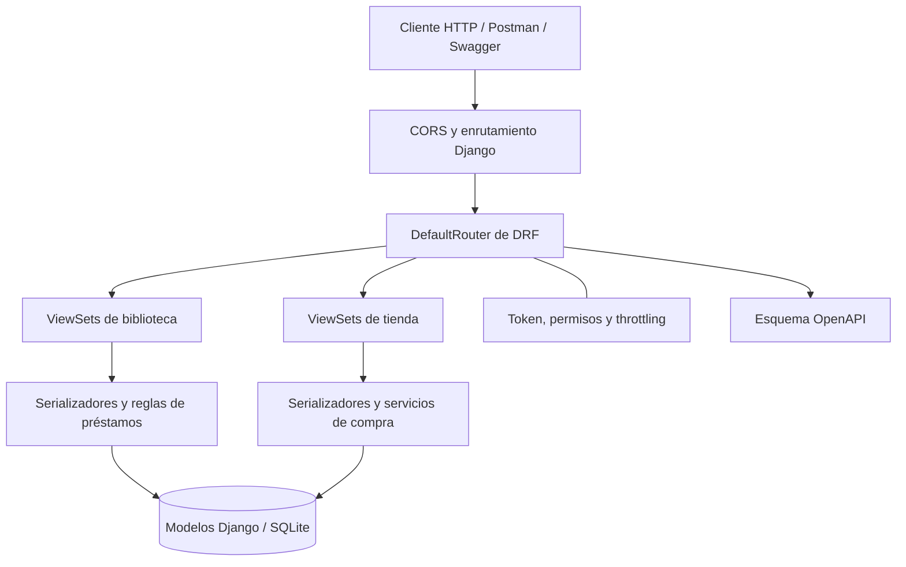

# Semana 13 · APIs REST con Django REST Framework

Práctica de Desarrollo de Aplicaciones Web (IS093A), UNCP. Incluye la Biblioteca Central y el catálogo, carrito, órdenes y reseñas de TecnoMarket Perú.

- [Informe técnico con capturas](output/pdf/Informe_Tecnico_Semana_13.pdf)
- [Colección de Postman](docs/Semana13.postman_collection.json)
- [Repositorio GitHub](https://github.com/taangel687-netizen/SEM13-AGUILAR2)

## Instalación

Se requiere Python 3.12 o superior. Ejecutar en PowerShell desde la raíz del repositorio.

```powershell
python -m venv .venv
.\.venv\Scripts\python -m pip install -r requirements.txt
.\.venv\Scripts\python manage.py migrate
.\.venv\Scripts\python populate_data.py
.\.venv\Scripts\python manage.py runserver
```

En Linux o macOS, usar `.venv/bin/python` en lugar de `.\.venv\Scripts\python`. La carga inicial genera 50 libros, 10 perfiles bibliotecarios y 30 préstamos, más 100 productos, 20 clientes, 50 órdenes y 100 reseñas verificadas. Los registros base existentes se conservan al volver a ejecutar la carga.

- API navegable en [http://127.0.0.1:8000/api/](http://127.0.0.1:8000/api/)
- Swagger UI en [http://127.0.0.1:8000/api/docs/](http://127.0.0.1:8000/api/docs/)
- ReDoc en [http://127.0.0.1:8000/api/redoc/](http://127.0.0.1:8000/api/redoc/)
- OpenAPI en [http://127.0.0.1:8000/api/schema/](http://127.0.0.1:8000/api/schema/)
- Administración en [http://127.0.0.1:8000/admin/](http://127.0.0.1:8000/admin/)

### Cuentas de demostración

| Cuenta | Rol |
| --- | --- |
| `demo_admin` | Administración |
| `demo_bibliotecario` | Edición de libros, registro y devolución de préstamos |
| `demo_cliente01` | Perfil e historial de biblioteca y compras en TecnoMarket |
| `demo_vendedor` | Gestión de productos propios y órdenes de su tienda |

La contraseña de estas cuentas ficticias es `PracticaLocal13!`. `populate_data.py --password <valor>` permite elegir otra al crear las cuentas. Importa la colección y ejecútala en orden con el Runner para que guarde los tokens y los identificadores de los registros creados. La colección usa IDs base de una instalación limpia.

## Arquitectura



## Endpoints

Todas las rutas de esta sección usan el prefijo `/api/`. En rutas de escritura con JSON, enviar `Content-Type: application/json`. Para operaciones privadas usar `Authorization: Token <token>`; Swagger usa el valor completo con el prefijo `Token`.

| Método y ruta | Ejemplo o finalidad |
| --- | --- |
| POST `token/` | `{"username":"demo_cliente01","password":"PracticaLocal13!"}` devuelve `token` y `expira`. |
| GET `autores/`, `autores/{id}/` | Consultar autores para obtener su ID. |
| GET `libros/`, `libros/{id}/` | `libros/?categoria=ingenieria&año__gte=2020&disponible=true&search=algoritmos&ordering=-año`. También acepta `anio__gte` y `ordering=titulo`. |
| POST `libros/`, PUT/PATCH/DELETE `libros/{id}/` | Ejemplo de PATCH `{"stock":7}`. Ejemplo completo en Swagger y Postman. |
| GET `usuarios/`, `usuarios/{id}/`, `usuarios/perfil/` | Lista administrativa con datos básicos, detalle privado y perfil propio. |
| GET/POST `prestamos/`, GET `prestamos/{id}/` | `{"usuario":1,"libro":31,"fecha_devolucion":"2027-01-15"}`. Usar una fecha vigente. |
| GET `prestamos/vencidos/?limit=3` | Vencidos con multa y paginación por desplazamiento. |
| POST `prestamos/{id}/devolver/` | Devuelve el ejemplar al stock. |
| GET `categorias/`, `categorias/{id}/`, `vendedores/{id}/` | Recursos relacionados del catálogo. |
| GET `productos/`, `productos/{id}/` | `productos/?categoria=laptops&marca=dell&precio_min=500&precio_max=2000&disponible=true&search=laptop&ordering=-precio`. |
| POST `productos/`, PUT/PATCH/DELETE `productos/{id}/` | Ejemplo de PATCH `{"descuento":10}`. Ejemplo completo en Swagger y Postman. |
| GET `carrito/` | Carrito activo del usuario. |
| POST `carrito/agregar/`, `carrito/actualizar/` | `{"producto":1,"cantidad":2}`. Agregar suma unidades; actualizar fija la cantidad. |
| POST `carrito/eliminar/`, `carrito/vaciar/` | Eliminar con `{"producto":1}`. Vaciar con cuerpo vacío. |
| POST `carrito/cupon/` | `{"codigo":"SEMANA13"}`; enviar código vacío para retirar el cupón. |
| POST `carrito/checkout/`, `ordenes/` | `{"direccion_envio":"Av. Real 250, Huancayo","metodo_pago":"transferencia"}`. |
| GET `ordenes/`, `ordenes/{id}/`, `ordenes/mis-ordenes/` | Ejemplo `ordenes/mis-ordenes/?limit=5&offset=0`. |
| PATCH `ordenes/{id}/` | `{"estado":"pagada"}`; después `enviada` y `entregada`. |
| POST `ordenes/{id}/cancelar/` | Cancela una orden pendiente y devuelve su stock. |
| GET/POST `reseñas/`, GET/DELETE `reseñas/{id}/` | `{"producto":1,"calificacion":5,"titulo":"Buena compra","comentario":"Coincide con la ficha."}`. |
| GET `productos/{id}/reseñas/` | Lista paginada de un producto. |

## Decisiones de diseño

- Los catálogos son públicos. Biblioteca usa páginas de 20 libros y TecnoMarket de 24 productos. Órdenes usan límites de 50 por defecto. Autor y categoría se leen anidados y se escriben mediante sus IDs.
- El cupo de cinco préstamos incluye todos los ejemplares sin devolver, incluso vencidos. El estado se calcula a partir de las fechas. La multa es de S/ 2 al día y queda fijada al devolver el ejemplar.
- Checkout revalida y descuenta stock dentro de una transacción, crea líneas con SKU, nombre y precio histórico, y vacía el carrito. El IGV es 18 % y el cupón reduce la base imponible. La cancelación y la devolución son idempotentes.
- El vendedor puede cambiar el estado de órdenes que contienen solo sus productos. Administración gestiona órdenes con varios vendedores. La confirmación de pago es un cambio manual de estado para la práctica.
- DRF autentica tokens de 24 horas y la administración conserva sesiones con CSRF. CORS permite los orígenes indicados por la guía, con credenciales. Las operaciones del flujo y los bloqueos por frecuencia se registran con identificadores internos.
- Los orígenes y umbrales se configuran en `config/settings.py`. SQLite usa transacciones de escritura `IMMEDIATE` para la demostración local. En un despliegue con varias réplicas, el caché usado por los throttles debe ser compartido.
- Las metas de carga, latencia y SLA de la guía requieren pruebas en infraestructura de producción. Pasarelas de pago, operadores logísticos, fidelidad y SDK móvil corresponden al contexto y objetivos de evolución del caso.

## Verificación

```powershell
.\.venv\Scripts\python manage.py test
.\.venv\Scripts\python manage.py makemigrations --check --dry-run
.\.venv\Scripts\python manage.py spectacular --validate --fail-on-warn --file .venv/schema.yaml
npx newman run docs/Semana13.postman_collection.json
```

